# Mosaicary

A Blockbench plugin with two halves.

- **The Mosaicary catalogue inside the editor.** Find a model on
  [mosaicary.com](https://mosaicary.com), turn it around with its animations, and
  open it as a project. A model there was made in Blockbench, so it opens as its
  author saved it: nothing is converted. Your own models go up from the same window.
- **A converter for everything else.** A glTF model — from an archive, a folder or
  straight from Sketchfab — is rebuilt out of cubes Minecraft can use: a GeckoLib or
  Bedrock model with bones and animations, a still Java block or item model, or a
  Customizable Player Models skin.

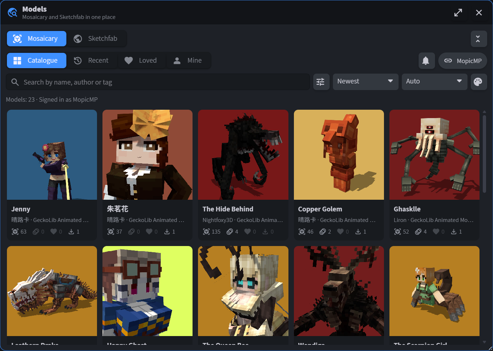

Free, under the MIT licence. Blockbench 4.9 or newer, desktop or web.

## Installation

**By URL (recommended)** — in Blockbench, *File → Plugins…*, then the *Load Plugin
from URL* button at the top of the window, and paste

```
https://raw.githubusercontent.com/MopicMP/mosaicary/main/plugin/gltf_to_minecraft.js
```

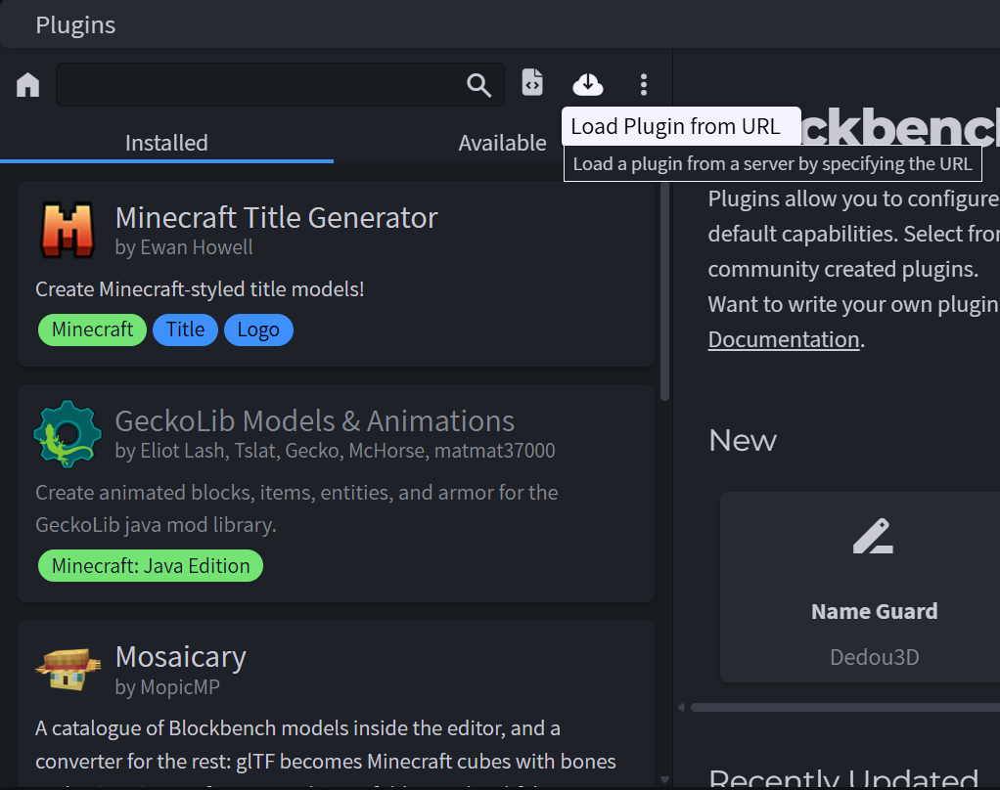

Blockbench reads a plugin loaded from a URL again at every start, so each new
version arrives by itself. Step by step with pictures:
[mosaicary.com/plugin](https://mosaicary.com/plugin).

**From the plugin list** — *File → Plugins…*, the *Available* tab. The list still
carries version 0.1.2 under the plugin's former name, **glTF to Minecraft**: the
converter without the catalogue window. Mosaicary 0.1.4 is submitted to it.

**From a file** — download [`plugin/gltf_to_minecraft.js`](plugin/gltf_to_minecraft.js)
and use *Load Plugin from File*. A file does not update itself.

## The catalogue

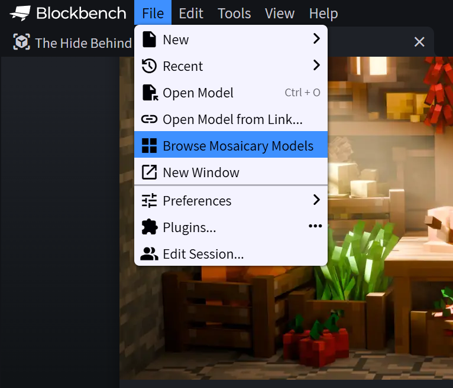

*File → Browse Mosaicary Models*, beside *Open Model*, opens the **Models** window
pictured at the top. It has two sources, Mosaicary and Sketchfab, and four shelves
on the Mosaicary side:

| Shelf | What it holds | Account |
|---|---|---|
| Catalogue | every published model | no |
| Recent | what you last opened in Blockbench | no |
| Loved | the models you put a heart on | yes |
| Mine | your own models, drafts included | yes |

Search goes by name, author or tag. The filters narrow by format, what the model is
for, detail, texture size, licence, tags, age, animations and cubes. The window can
also sit as a panel in Blockbench's sidebar.

A click on a card opens the model's own window: the model turning with its
animations, what it is made of, its licence and author, its description, tags and
comments.

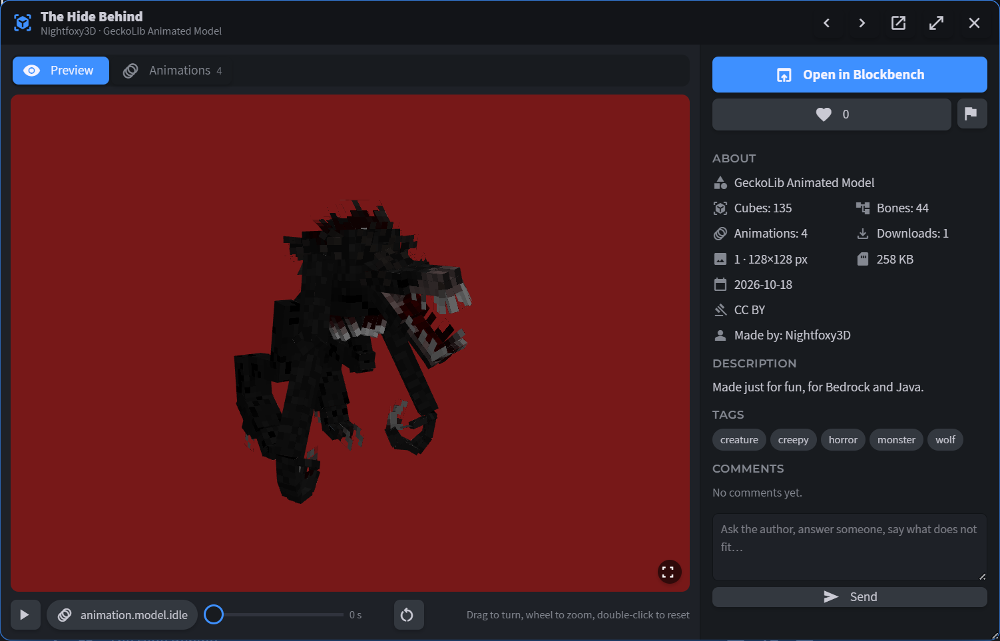

*Open in Blockbench* downloads it and opens it as a project, bones and animations
included.

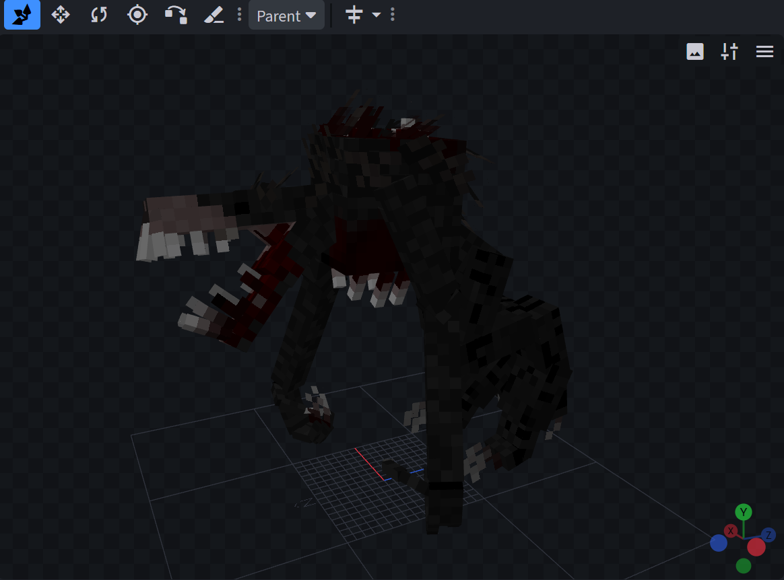

**The account.** Browsing, searching and downloading need none. A heart, a comment,
the Loved and Mine shelves and uploading do. Signing in is a code confirmed in the
browser, or a key pasted by hand for a Blockbench whose browser does not open;
either way the plugin keeps an ordinary API key, which the site lists and revokes
under *My models → API keys*. A key can publish and update, never delete.

**Uploading.** *File → Upload Model to Mosaicary*, beside the exports, puts the open
project up — published, or as a draft nobody else sees. The card's picture is drawn
in the same window: turn the model, pick the background, and for an animated model
the animation and the moment in it.

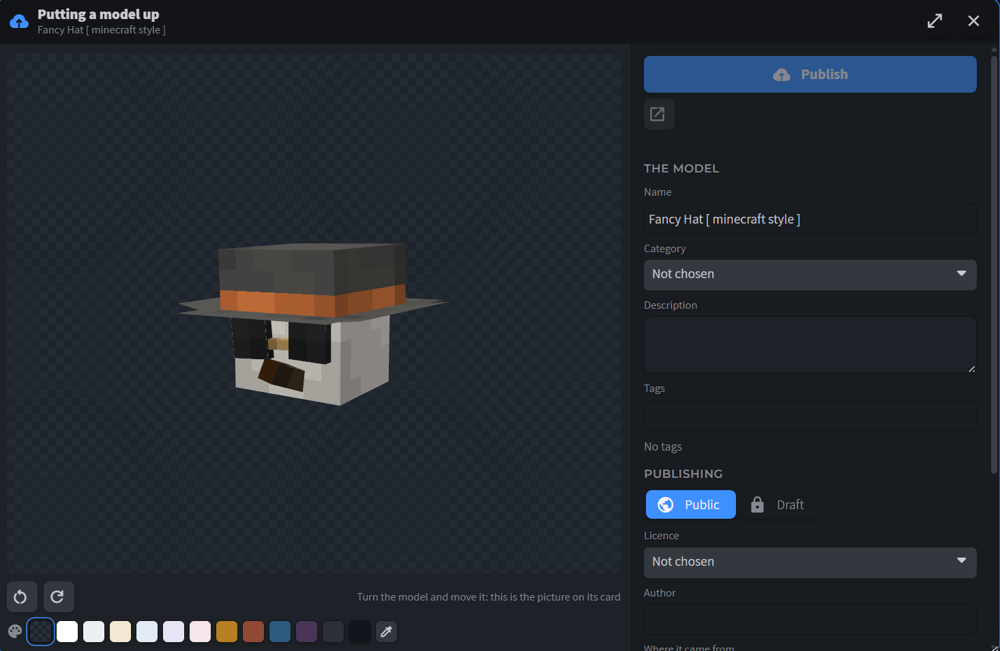

A setting, off until you turn it on, keeps a draft up to date each time the project
is saved.

**Reviews.** *Help → Leave a Review* writes what you think of the plugin or of the
site on its public wall.

All of this in full: [the catalogue, the account and uploading](docs/the-catalogue.md).
What the plugin sends and keeps: [what it touches](docs/what-it-touches.md).

## Sketchfab

The **Sketchfab** tab of the same window searches Sketchfab through its official
Data API; *File → Import → Import from Sketchfab* opens the window there. Searching
needs nothing. Downloading needs a free personal API token, from the Sketchfab
profile settings under *Password & API*.

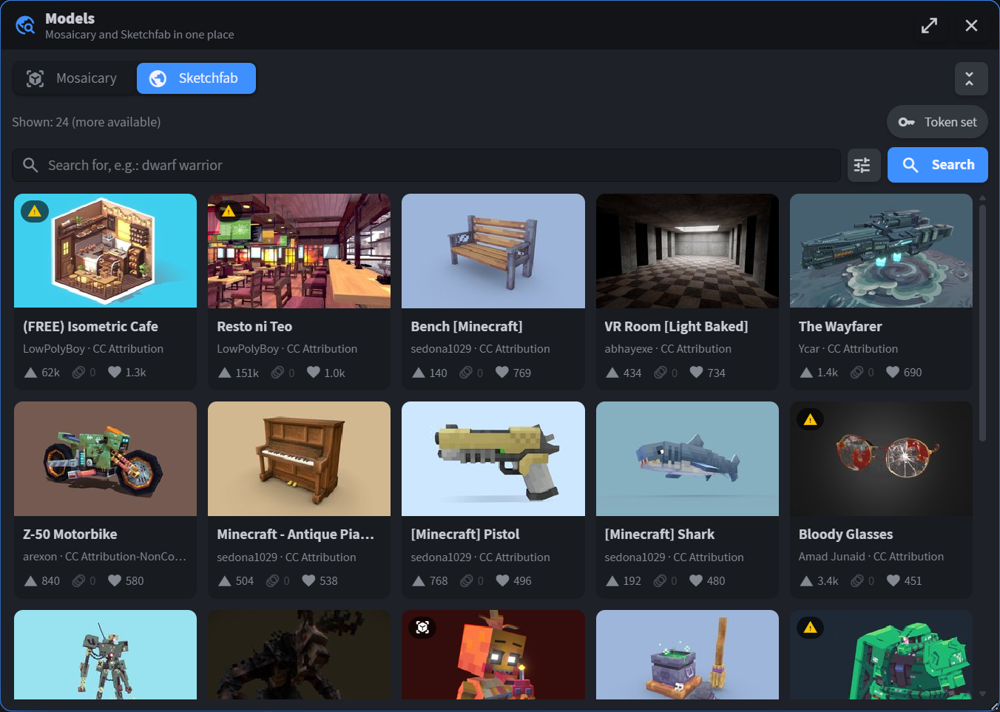

Every card shows the author and the licence, the triangle count, the number of
animations and the likes.

- **Made in Blockbench**, on by default, lists only models tagged `blockbench`.
  Those are mostly built from cubes and convert whole; most of Sketchfab is sculpts,
  which do not.
- The tag proves nothing on its own, so a card also says how the model looks to be
  built. A **cube** icon: separate cubes, it should convert whole. A **warning**
  icon: shared corners, so slopes and curves, which turn into plates. No icon: a mix.
- **Animated** leaves only models with at least one animation.
- **Order**: relevance, most liked, most viewed or newest. Sketchfab has no order by
  downloads.
- **Models that cannot be downloaded** are listed too, marked with a lock, since
  leaving them out made the search look several times smaller than the same search on
  Sketchfab. Their window offers the model's page instead of an import. A switch in
  the filters leaves them out.

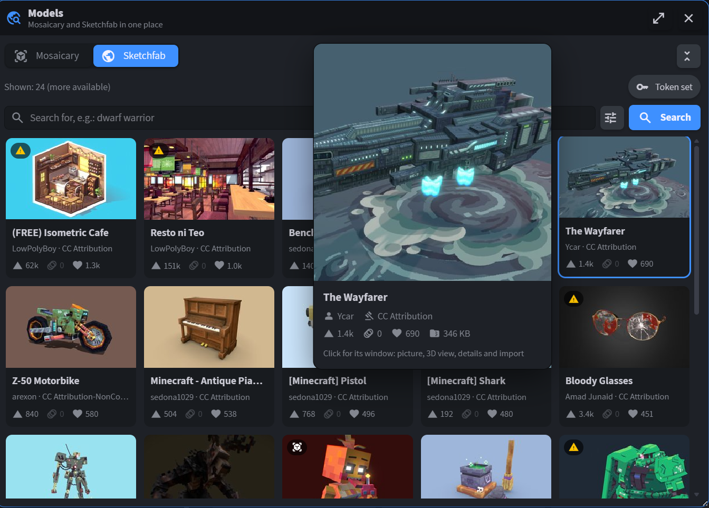

A click on a card opens its window: the picture, a 3D view drawn from the model's
own geometry, the details, and *Import*. Looking in 3D downloads the model, and the
import then reuses that download instead of fetching it twice.

For a model uploaded straight from Blockbench, the author's original file is
downloaded rather than Sketchfab's conversion of it: the conversion was seen losing a
texture's transparency. The report says when the original was used.

## Importing a glTF model

*File → Import → Import glTF Model*, or the tile on the start screen. Pick a `.zip`,
or the files of an unpacked folder: the `.gltf` or `.glb`, its `.bin` and the
textures. Textures may be PNG, JPEG, GIF or WebP. A model from Sketchfab arrives at
the same window.

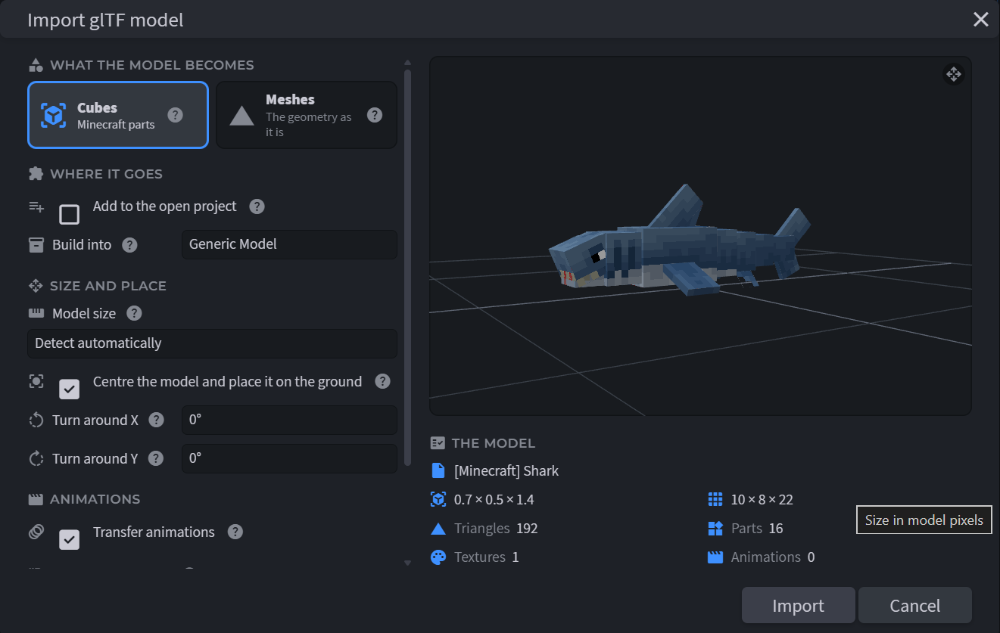

**What the model becomes.** *Cubes*, the default, because cubes are what the game
renders. *Meshes* keeps the author's geometry as it is, for looking a model over and
taking parts out of it; bones, textures and animations come across the same way.

**Where it goes.** The format to build into:

| Format | For | Bones and animations |
|---|---|---|
| GeckoLib | Java mods using GeckoLib | yes |
| Bedrock Entity | Bedrock add-ons | yes |
| Generic Model | converting further with *File → Convert Project*, or exporting glTF or OBJ | yes |
| Java Block/Item | resource packs | no, the model is still |

A Java block or item model is moved into the box Minecraft allows — every element
within −16…32 on each axis — and shrunk only if it is larger. The report says which
Minecraft version its cube rotations need, and the project's Java format is raised
to it.

**Size and place.** The model size is detected, or set by hand. Centring stands the
model on the ground. It can be turned around X and Y.

**Animations** are carried over on all three channels — rotation, position and
scale — with step and cubic-spline interpolation read from the file.

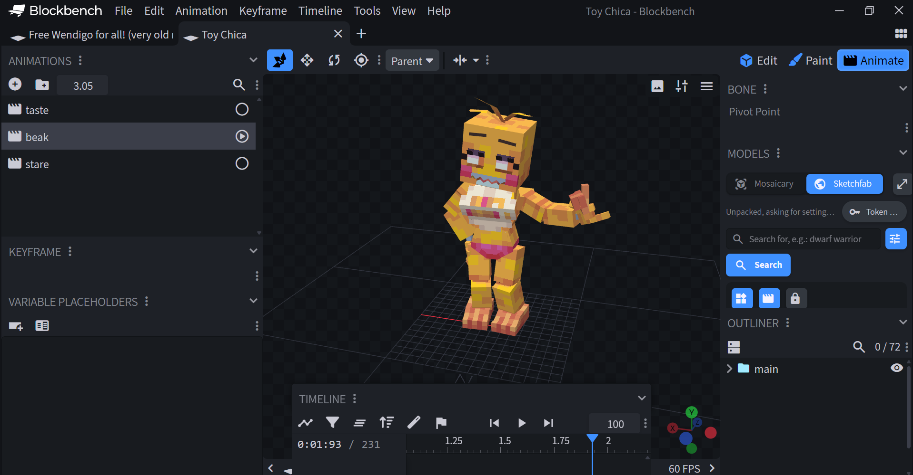

**Rounded parts.** Wedges, bevels and curves do not exist in Minecraft. They are
rebuilt from thin plates that follow their surface, each cut to its outline by a
baked texture, the way curves are built by hand in Blockbench. *Best* also lays strips
along sharp slanted edges.

**Advanced settings**, behind a checkbox, are levers for diagnosing a model that
comes out wrong; change them one at a time.

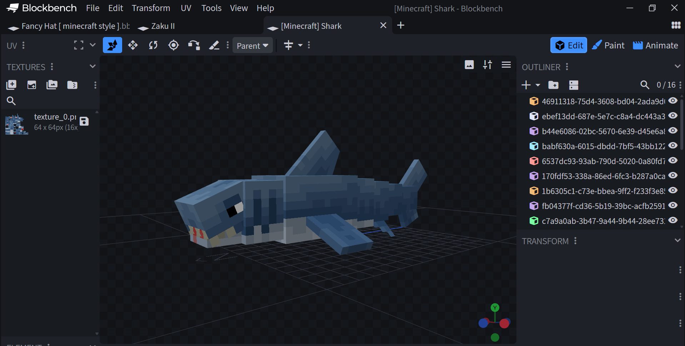

When it is done, the report says what was built: the format, cubes, bones,
texture, animations and scale, and how many parts were rebuilt into how many cubes.
*Import details* opens the full log, with the warnings and, for a model from
Sketchfab, its author and licence.

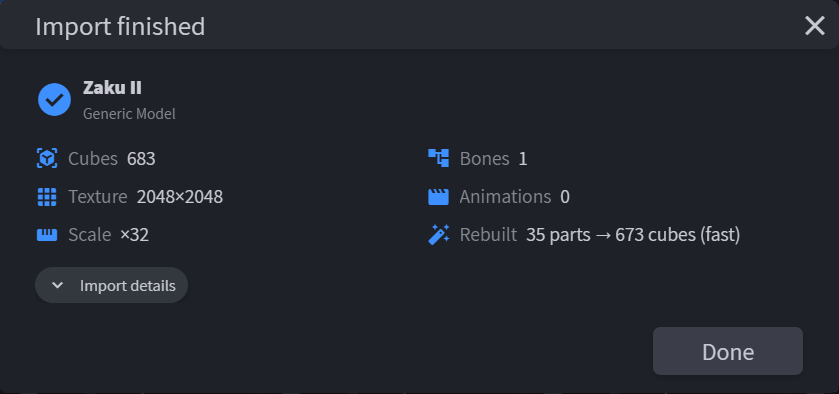

What else happens on the way:

- Several textures are packed into one atlas, because GeckoLib and Bedrock want one.
- Merged meshes are split back into separate cubes: many exporters emit 708 triangles
  where the model has 59 boxes.
- Coplanar faces are pulled apart through `Inflate`, so the model does not flicker,
  while coordinates stay clean.
- The outliner is tidied: folders that hold one thing and carry no animation are
  dropped, and cubes keep their author's names.

### Adding to the open project

With a project open in one of these formats, the import window offers *Add to the
open project*. The model takes that project's format and arrives as one folder: into
the selected folder, standing on its pivot, so a sword put into a hand turns with
it. Its animations are left out unless *Add its animations too* is ticked. One undo
takes it all back.

| Format | The model's texture |
|---|---|
| GeckoLib, Bedrock Entity | drawn beside the project texture, which grows to hold both |
| Generic Model | added as a texture of its own |
| Java Block/Item | added as a texture of its own, its UV fitted to the project's UV size |

### Meshes already in a project

*Tools → Convert Meshes to Cubes* turns box-shaped meshes of the open project into
cubes, carrying the UV over. It is shown while the project holds a mesh.

## Customizable Player Models

*File → Import → Import glTF as Customizable Player Model* runs the same import and
then asks what a player skin needs and a GeckoLib model does not: the height in
player pixels, which bone is which part of the player, and what each animation
becomes — a vanilla pose (`walking`, `sneaking`, `sleeping`…) or a gesture. Then it
saves a `.cpmproject`.

The bone mapping is offered, not decided: a guess by name is filled in, and on a
model rigged like a player it needs no corrections. The report states the encoded
size against CPM's 30 kB budget for a local model.

Details: [How it works — Customizable Player Models](docs/how-it-works.md#6-customizable-player-models).

## What it cannot do

Rounded parts need cutout transparency wherever the model is used, and the report
says so. Up close their slanted edges show fine steps; *Best* straightens them at 1.5
to 2 times the cubes. A model made mostly of such parts gets many times more cubes
than it has objects. The advanced settings can instead replace each with its bounding
box, skip them, or cancel the import.

Coordinates are cleaned of floating-point noise (`4.99998` becomes `5`), but a model
not built on a 0.25 px grid keeps its exact numbers: snapping it would grow small
details and flatten thin overlays.

## Requirements

Nothing beyond Blockbench, for any of the formats.

GeckoLib used to come from a plugin of its own. Where that plugin is not installed,
this one registers the format itself under the same id, so the files stay the ones
the GeckoLib plugin reads and writes, and adds *File → Export GeckoLib Geometry* for
the `.geo.json` the mod reads. Their plugin — **GeckoLib Models & Animations** on
Blockbench 5, **GeckoLib Animation Utils** on Blockbench 4 — is still worth having for
its own settings and exports; where it is installed it stays in charge, and our
export entry is not shown.

Downloading from Sketchfab needs a personal API token, see [Sketchfab](#sketchfab).

## Questions people ask

### How do I import a Sketchfab model into Blockbench?

Install the plugin, then *File → Import → Import from Sketchfab*. Search, open a
card, press *Import*, and the model is downloaded and rebuilt out of cubes.
Searching is free; downloading needs a free Sketchfab API token, from *Settings →
Password & API* on Sketchfab. Models their author does not allow anyone to download
are listed with a lock and cannot be imported.

### How do I convert a glTF or GLB model into a Minecraft model?

*File → Import → Import glTF Model*, then pick a `.zip`, or the `.gltf`/`.glb` file
together with its `.bin` and textures. Choose the format — GeckoLib, Bedrock Entity,
Generic Model or a Java block/item model — and the model arrives as cubes, with bones,
textures and animations where the format has them.

### How do I turn a 3D model into a GeckoLib entity or a Bedrock mob?

Import it as above and choose *GeckoLib* (Java mods) or *Bedrock Entity* (add-ons).
The bones keep their hierarchy and animations are carried over. Neither needs another
plugin.

### How do I make a block or item model for a resource pack from a glTF?

Choose *Java Block/Item* in the import window. The model is fitted into the box
Minecraft allows, and the report says which Minecraft version its cube rotations
need.

### Can I use a 3D model as a Customizable Player Models skin?

Yes: *File → Import → Import glTF as Customizable Player Model*. See
[Customizable Player Models](#customizable-player-models).

### Blockbench opens my glTF as meshes. How do I get cubes?

Blockbench's own glTF import keeps every element a mesh, which Minecraft formats
cannot take. This plugin rebuilds the model out of cubes: boxes stay boxes, rounded
parts become thin turned plates. Meshes already in a project go through *Tools →
Convert Meshes to Cubes*.

### Are animations kept?

Yes, for GeckoLib, Bedrock Entity and Generic Model: rotation, position and scale.
Java block and item models do not animate.

### Why do some faces come out black, or the whole model wear one texture?

Usually the file lost something on its way — a texture's transparency, or which part
uses which material. The report says so when it can tell;
[troubleshooting](docs/troubleshooting.md) lists the causes and what to do.

### Where do I find Blockbench models to download?

On [mosaicary.com](https://mosaicary.com), or in Blockbench itself through *File →
Browse Mosaicary Models*. Its models are made in Blockbench, and every one of them
can be downloaded.

### Is it free?

Yes, under the MIT licence. Imported models keep their own licences.

## Testing without Blockbench

The converter core does not depend on Blockbench, so it runs from Node and catches
maths errors without opening the editor:

```bash
node tools/verify-conversion.mjs model/model.obj    # box detection and UV layout
node tools/verify-gltf.mjs        model/model.obj    # glTF parsing against a baseline
node tools/verify-real-gltf.mjs   model/model.obj    # a real glTF against a reference from its OBJ
node tools/verify-snap.mjs                           # grid snapping and its cost
node tools/verify-coplanar.mjs                       # coplanar face separation
node tools/verify-animation.mjs                      # animation maths: the pose Blockbench will assemble
node tools/verify-wrapper.mjs                        # the export wrapper: what is kept, what is thrown away
node tools/verify-approx.mjs                         # bounding-box approximation: where the texture lands
node tools/verify-images.mjs                         # PNG/JPEG/GIF/WebP headers
node tools/verify-import-limits.mjs                  # hostile input limits and valid controls
node tools/verify-cpm.mjs                            # .cpmproject: structure, limits, geometry
node tools/verify-java-fit.mjs                       # Java models: the box and the Minecraft version
node tools/verify-outliner.mjs                       # the outliner: folders dropped, none animated lost
node tools/verify-per-face-textures.mjs              # a texture per face, and faces with none
node tools/verify-rounded.mjs                        # parts that are not boxes: plates, strips, texel, culling
node tools/verify-quirks.mjs                         # file quirks: hair-thin panels, specular-glossiness, outline shells
node tools/verify-add-to-project.mjs                 # adding to an open project: texture placement, names
node tools/verify-strips.mjs                         # triangle strips and fans, on real models
node tools/verify-search-filter.mjs --live           # Sketchfab filters and orders, against the live API
node tools/smoke-plugin.mjs                          # the whole import path
```

`smoke-plugin` stands in for Blockbench's objects (`Cube`, `Group`, `Animation`,
`THREE`, `JSZip`…) and runs the entire import on several archives, builds the same
model into every format, adds it to open projects of each, and runs the CPM export.
It catches what `node --check` misses: reading a `const` before its declaration,
typos in names, calls to functions that do not exist.

## Documentation

- [How it works](docs/how-it-works.md) — reading glTF, turning meshes into cubes,
  texture layout, coordinates, animations, the CPM export, formats, adding to an open
  project, parts that are not boxes, the limits a file is held to, and the import
  window.
- [The catalogue, the account and uploading](docs/the-catalogue.md) — the window and
  its shelves, finding a model, looking one over, Sketchfab and the models that
  cannot be downloaded, signing in, uploading, reviews, drafts that follow saving.
- [What the plugin touches](docs/what-it-touches.md) — every entry it adds to
  Blockbench, what it calls, what leaves this computer, what it keeps on it, and what
  is known to be wrong.
- [Why a model comes out wrong](docs/troubleshooting.md) — the common symptoms, what
  causes them and what to do, for the conversion and for the catalogue alike.

## Licence

MIT, see [LICENSE](LICENSE).

Imported models keep their own licence. Most Sketchfab models require attribution, so
the import report always prints the author and the licence.

The models in the screenshots belong to their authors, named on each card. Shown up
close: *The Hide Behind* by Nightfoxy3D (CC BY), from Mosaicary; from Sketchfab,
all CC Attribution, *[Minecraft] Shark* by sedona1029, *Toy Chica* by 晴路卡,
*Zaku II* by taj_tajima and *Fancy Hat [ minecraft style ]* by LepikGem.
